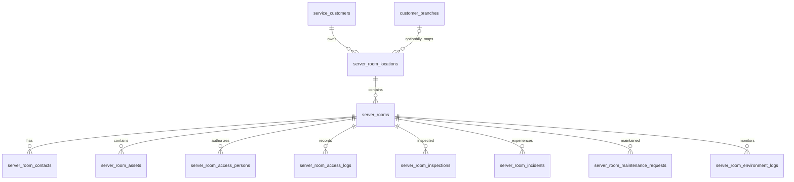
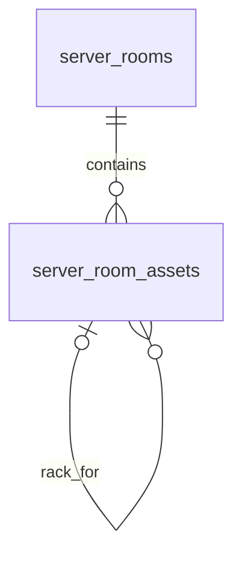
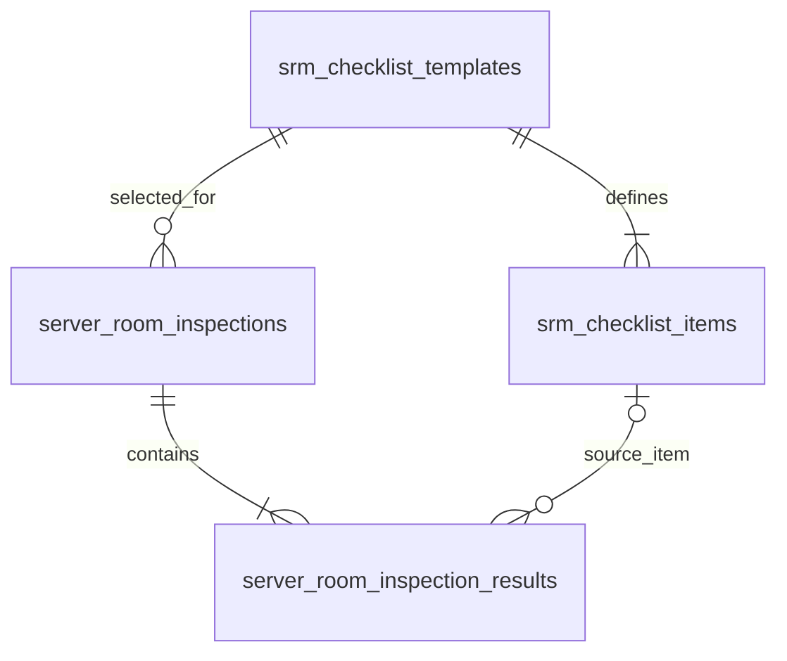
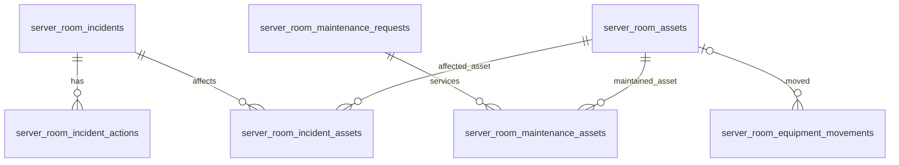

# SRM – ERD và quan hệ dữ liệu (bản thiết kế đề xuất)

> Trạng thái: DRAFT. Đây là ERD logic đề xuất, chưa phải schema được duyệt để chạy Migration. Các bảng và quan hệ phải được đối chiếu với database hiện tại trước khi triển khai.

## 1. Phân cấp tenant – địa điểm – phòng

- service_customers là tenant gốc.
- server_room_locations.customer_id xác định chủ thể quản lý dữ liệu.
- branch_id là liên kết tùy chọn tới chi nhánh của cùng khách hàng.
- Data Center là thông tin địa điểm/nhà cung cấp, không phải tenant thay thế khách hàng.
- Một location chứa nhiều server rooms; mỗi room thuộc đúng một location.

## 2. Tài sản và Rack

Đề xuất chưa tạo bảng Rack riêng. Rack được biểu diễn bằng một bản ghi trong server_room_assets có category=rack. Thiết bị đặt trong Rack tham chiếu bản ghi Rack đó:

- Bổ sung rack_asset_id BIGINT UNSIGNED NULL tự tham chiếu server_room_assets.id.
- Bổ sung rack_u_start SMALLINT UNSIGNED NULL.
- Bổ sung rack_u_height SMALLINT UNSIGNED NULL.
- Bổ sung rack_total_u SMALLINT UNSIGNED NULL, chỉ áp dụng khi bản ghi là Rack.
- Rack phải thuộc cùng customer_id và server_room_id với thiết bị được gắn vào.
- Rack không được tự tham chiếu chính nó; không cho Rack làm rack con của Rack khác trong mô hình đơn giản này.
- Kiểm tra trùng U và giới hạn rack_u_start + rack_u_height - 1 <= rack_total_u ở service layer/transaction.

Nếu về sau cần quản lý patch panel, PDU theo unit, sơ đồ mặt trước/sau hoặc rack cabinet có nhiều khoang, có thể tách Rack thành thực thể riêng.

## 3. Sự cố và bảo trì liên kết nhiều thiết bị

Một sự cố hoặc một đợt bảo trì có thể tác động đến nhiều thiết bị. Không đặt một asset_id duy nhất trong bảng cha hoặc lưu danh sách ID dạng JSON.

### server_room_incident_assets

| Cột | Kiểu dự kiến | Ghi chú |
|---|---|---|
| id | BIGINT UNSIGNED | PK |
| customer_id | BIGINT UNSIGNED | Tenant |
| incident_id | BIGINT UNSIGNED | FK sự cố |
| asset_id | BIGINT UNSIGNED | FK thiết bị |
| impact_note | TEXT NULL | Ảnh hưởng lên thiết bị |
| created_at | TIMESTAMP | |

Unique: (incident_id, asset_id). Sự cố và tài sản phải thuộc cùng tenant.

### server_room_maintenance_assets

| Cột | Kiểu dự kiến | Ghi chú |
|---|---|---|
| id | BIGINT UNSIGNED | PK |
| customer_id | BIGINT UNSIGNED | Tenant |
| maintenance_request_id | BIGINT UNSIGNED | FK yêu cầu bảo trì |
| asset_id | BIGINT UNSIGNED | FK thiết bị |
| work_note | TEXT NULL | Công việc trên thiết bị |
| created_at | TIMESTAMP | |

Unique: (maintenance_request_id, asset_id). Yêu cầu bảo trì và tài sản phải cùng tenant. Có thể bổ sung relation_type nếu cần phân biệt affected/serviced/replaced.

## 4. Di chuyển thiết bị

`server_room_equipment_movements` hỗ trợ check-in, check-out và relocate trong cùng tenant. Thiết kế dùng `from_server_room_id` và `to_server_room_id`; không dùng một `server_room_id` để biểu diễn cả nguồn và đích.

Các trường và quan hệ chính:
- `asset_id` nullable cho thiết bị chưa có Asset Record (chỉ theo điều kiện B13).
- `movement_type`: `check_in`, `check_out`, `relocate`.
- Timestamp tách biệt: `requested_at` (tạo yêu cầu) và `executed_at` (hoàn tất thực tế).
- Lifecycle: `draft` → `pending_approval` → `approved` → `completed`; có nhánh `rejected` và `cancelled`.
- Rack/U nguồn và đích dùng `from_rack_asset_id`, `from_rack_u_start`, `to_rack_asset_id`, `to_rack_u_start`; Rack phải thuộc đúng Server Room tương ứng. Text location chỉ là ghi chú.
- Snapshot thiết bị gồm tên, Serial Number và Asset Tag nếu có; snapshot vị trí nguồn/đích phải được giữ để bảo toàn lịch sử.

Quy tắc theo loại:
- `check_in`: `from_server_room_id = NULL`, `to_server_room_id` bắt buộc.
- `check_out`: `from_server_room_id` bắt buộc, `to_server_room_id = NULL`.
- `relocate`: from/to bắt buộc; có thể cùng phòng nếu chỉ đổi Rack/U.
- `relocate`/`check_out` chỉ execute khi Asset hiện đang thuộc phòng nguồn; check lại bên trong transaction.
- `check_out` không xóa Asset Record; chuyển Asset sang `checked_out` hoặc trạng thái tương đương trong allowlist. Khi quay lại, tạo Movement `check_in` mới.
- `asset_id = NULL` chỉ dùng cho thiết bị ngoài danh mục; check-in không tự động tạo Asset Record.

Execute chỉ được thực hiện từ trạng thái `approved`. Hệ thống khóa Asset bằng row-level lock (`SELECT ... FOR UPDATE`), cập nhật Asset và Movement trong cùng Database Transaction; nếu source validation hoặc cập nhật thất bại thì rollback toàn bộ. Movement `completed` là hồ sơ bất biến; sai sót phải lập phiếu mới.

## 5. Checklist và Inspection

- Template có version; không sửa nội dung phiên bản đã được duyệt/sử dụng theo cách làm thay đổi lịch sử.
- Inspection lưu template_id và template_version.
- Result lưu snapshot mã, tên, mô tả và response type của checklist item.
- checklist_item_id có thể NULL nếu item nguồn bị archive; snapshot vẫn đủ để hiển thị lịch sử.
- Phiếu đã submit không được thay đổi âm thầm; mọi reopen/correction cần audit.

## 6. Incident, action, maintenance, movement

## 7. Approval, Attachment, Audit

server_room_approvals, server_room_attachments, server_room_audit_logs dự kiến dùng polymorphic key (type/id).

Ưu điểm: gắn được nhiều loại đối tượng SRM. Hạn chế: MySQL không thể đặt một FK thông thường từ ID đến nhiều bảng khác nhau.

Bắt buộc:
- Validate object tồn tại và thuộc đúng customer_id ở service layer.
- Không cho client tự truyền class/type tùy ý; dùng allowlist model type.
- Tải file phải authorize tenant và đối tượng trước khi trả file.
- Audit log append-only ở tầng ứng dụng; hạn chế quyền sửa/xóa.
- Nếu cần FK cứng tuyệt đối, thay polymorphic bằng bảng cha chung hoặc bảng liên kết chuyên biệt; cần cân nhắc chi phí và độ phức tạp.

## 8. Tenant integrity và FK đề xuất

Đối với bảng cha có tenant, cân nhắc unique key ghép (id, customer_id), sau đó bảng con tham chiếu cả hai cột. Ví dụ:

- server_room_locations: UNIQUE (id, customer_id).
- server_rooms: UNIQUE (id, customer_id).
- server_room_assets: UNIQUE (id, customer_id, server_room_id) nếu cần kiểm soát đồng thời tenant và room.
- srm_checklist_templates: UNIQUE (id, customer_id).

Khi dùng composite FK, cột con phải có đúng kiểu, thứ tự và index tương ứng. Với FK đến users, cần xác định user nội bộ và user khách hàng có được phép thao tác trên tenant nào; không thể chỉ dựa vào users.id để suy ra quyền.

Không tự ý thêm/sửa unique index trên các bảng hiện hữu trước khi kiểm tra duplicate data và tác động đến quan hệ hiện tại.

## 9. Quy tắc xóa dữ liệu đề xuất

| Quan hệ | Quy tắc đề xuất | Lý do |
|---|---|---|
| Customer → Location | RESTRICT / soft delete | Bảo toàn dữ liệu khách hàng |
| Location → Room | RESTRICT / soft delete | Không xóa phòng còn hồ sơ |
| Room → Assets | RESTRICT / soft delete | Bảo toàn kiểm kê |
| Room → Access Logs | RESTRICT | Nhật ký phải giữ |
| Room → Inspections | RESTRICT | Hồ sơ kiểm tra phải giữ |
| Inspection → Results | CASCADE chỉ khi xóa phiếu nháp chưa submit; còn lại RESTRICT | Không mất lịch sử |
| Incident → Actions | RESTRICT sau khi phát sinh; dùng trạng thái | Bảo toàn khắc phục |
| Asset → Movement | RESTRICT | Bảo toàn lịch sử di chuyển |
| User → actor fields | SET NULL khi phù hợp | Giữ hồ sơ khi user bị xóa |
| Checklist Item → Result | SET NULL | Snapshot giữ dữ liệu cũ |
| Approval/Attachment/Audit | Không cascade từ đối tượng nghiệp vụ đã lưu trữ | Bảo toàn bằng chứng và audit |

Hành vi xóa cuối cùng phải đối chiếu với soft-delete và chính sách retention hiện hữu.

## 10. Những điểm chưa được chốt

1. Có cần Rack layout 2D/3D, front/rear view hoặc patch panel hay không.
2. Quy tắc di chuyển giữa các khách hàng: đề xuất cấm; chỉ movement trong cùng tenant.
3. Có cần nhiều người phê duyệt đồng thời ở một bước hay chỉ tuần tự.
4. Người dùng ngoài hệ thống được ghi nhận bằng snapshot hay cần bảng danh bạ riêng.
5. Có cần sensor integration để tự động ghi Environment Logs ở giai đoạn đầu.
6. Chính sách retention, lưu trữ và xóa file/audit.
7. Xác minh khả năng hỗ trợ composite FK của schema hiện hữu và quy ước migration.

## 11. Phạm vi bảng sau rà soát ERD

- 18 bảng nghiệp vụ cốt lõi đã liệt kê trong Data Dictionary.
- 2 bảng liên kết đề xuất: server_room_incident_assets, server_room_maintenance_assets.
- Rack chưa cần bảng riêng; dùng self-reference trên server_room_assets.

Tổng dự kiến: 22 bảng (18 core + 2 pivot + 2 access-control).

---

## 12. Phân quyền Customer User – quan hệ đã chốt

Chủ dự án đã chốt:
- Customer account dùng customer_user_srm_permissions để cấp quyền chức năng.
- Customer user chỉ truy cập phòng Server được gán.
- Customer IT Admin được cấp/thu hồi quyền và gán phòng cho user cùng tenant.

~~~mermaid
erDiagram
    service_customers ||--o{ customer_user_srm_permissions : scopes
    users ||--o{ customer_user_srm_permissions : receives
    service_customers ||--o{ customer_user_server_rooms : scopes
    users ||--o{ customer_user_server_rooms : assigned
    server_rooms ||--o{ customer_user_server_rooms : room_scope
~~~

Ràng buộc:
- customer_user_srm_permissions.customer_id = users.service_customer_id.
- customer_user_server_rooms.customer_id phải bằng users.service_customer_id và server_rooms.customer_id.
- Customer IT Admin chỉ quản trị user cùng tenant và chỉ cấp quyền thuộc allowlist.
- Không có assignment thì deny by default.
- can_access_all_branches không thay thế room assignment.
- Cấp/thu hồi quyền và assignment phải được audit.

Tổng số bảng dự kiến: 22 (18 core + 2 pivots + 2 access-control).

## 13. Chuẩn hóa số lượng bảng và quan hệ Movement

Danh mục ERD phải được hiểu thống nhất là 22 bảng: 18 core, 2 pivot (`server_room_incident_assets`, `server_room_maintenance_assets`) và 2 access-control (`customer_user_srm_permissions`, `customer_user_server_rooms`).

Equipment Movement dùng `from_server_room_id` và `to_server_room_id`; điều kiện bắt buộc theo `movement_type` được quy định tại Data Integrity & State Machines. Cả hai đầu quan hệ, cùng asset (nếu có), phải thuộc cùng `customer_id`.

## 14. Quan hệ Approval Delegation – bổ sung bảng thứ 23

Bổ sung `server_room_approval_delegations` liên kết tenant và hai user (principal/delegate), tùy chọn giới hạn loại hồ sơ và phòng Server, thời hạn hiệu lực, người duyệt và người thu hồi.

Quan hệ logic:
- `service_customers` 1–N `server_room_approval_delegations`.
- `users` (principal) 1–N delegation; `users` (delegate) 1–N delegation.
- `server_rooms` 0–N delegation theo scope tùy chọn.
- Một delegation có thể được tham chiếu bởi nhiều approval rows nếu các cấp được kích hoạt trong thời hạn/phạm vi; mỗi approval row snapshot `approver_id`, `acting_approver_id` và `delegation_id`.

Tại thời điểm kích hoạt cấp, hệ thống resolve approver group/role thành principal users trước (C05), sau đó kiểm tra delegation hợp lệ và ghi acting approver. Thay đổi/thu hồi delegation sau thời điểm này không thay đổi approval row đã snapshot. Tổng thiết kế: 23 bảng (18 core, 2 pivot, 2 access-control, 1 delegation).

## C11 – Xác nhận tên cột Pivot (APPROVED – 2026-11-15)

- Quan hệ Incident–Asset sử dụng `server_room_incident_assets.impact_note`.
- Quan hệ Maintenance–Asset sử dụng `server_room_maintenance_assets.work_note`.
- Giữ hai tên riêng theo ngữ nghĩa nghiệp vụ; không chuẩn hóa thành tên chung `relationship_note`.

## C12 – Snapshot Asset trên các Pivot (APPROVED – 2026-11-15)

- Quan hệ Incident–Asset (`server_room_incident_assets`) và Maintenance–Asset (`server_room_maintenance_assets`) lưu `asset_tag` và `asset_name` snapshot tại thời điểm liên kết.
- Snapshot bảo toàn ngữ cảnh lịch sử khi Asset gốc được đổi tên hoặc đổi mã; không thay thế FK tới Asset hiện tại.

## C13 – Room Scope của các quan hệ Pivot (APPROVED – 2026-11-15)

- Incident–Asset: cho phép quan hệ qua nhiều Server Room nhưng bắt buộc cùng `customer_id`.
- Maintenance–Asset: mặc định cùng Server Room; trường hợp đa phòng phải được yêu cầu bảo trì khai báo tường minh.
- Room scope là quy tắc nghiệp vụ trên quan hệ; không ép Incident đa phòng thành một Room duy nhất.

## D04 – Foreign Key and Referential Integrity Policy (APPROVED – 2026-11-15)

1. Dùng Foreign Key cho các quan hệ nội bộ SRM có đích tham chiếu và khóa được xác định rõ, tương thích với schema thực tế.
2. Quan hệ polymorphic như `approvable_type`/`approvable_id` và `attachable_type`/`attachable_id` không thể được bảo vệ bằng một FK SQL trực tiếp; Service phải kiểm tra loại đối tượng, sự tồn tại, tenant ownership và quyền truy cập trước khi thao tác.
3. Không dùng `ON DELETE CASCADE` cho dữ liệu nghiệp vụ, lịch sử và Audit SRM.
4. Ưu tiên `RESTRICT`/`NO ACTION` để ngăn xóa bản ghi cha khi còn dữ liệu con liên quan; việc xóa vật lý chỉ được xem xét sau khi đáp ứng retention, Legal Hold và quy trình kiểm soát đã duyệt.
5. Soft Delete không xóa bản ghi vật lý và không được làm mất tính toàn vẹn tham chiếu; Service phải xác định rõ cách xử lý record soft-deleted trong từng nghiệp vụ.
6. Trước khi tạo FK, phải kiểm tra dữ liệu orphan, kiểu dữ liệu/unsigned, index và thứ tự migration; không tạo constraint nếu dữ liệu hiện hữu chưa đạt điều kiện.
7. Kiểm thử bắt buộc: ngăn xóa cha còn con, ngăn tham chiếu chéo tenant, kiểm tra polymorphic reference hợp lệ và xử lý soft-deleted parent.

## D05 – Unique Index and Duplicate Prevention Policy (APPROVED – 2026-11-15)

1. Các mã định danh nghiệp vụ phải có uniqueness phù hợp với phạm vi áp dụng; với dữ liệu thuộc tenant, phạm vi unique phải bao gồm `customer_id` khi nghiệp vụ yêu cầu mã chỉ duy nhất trong tenant.
2. Những bản ghi chỉ được phép tồn tại một trạng thái active cho cùng một business key phải có cơ chế bảo đảm uniqueness ở database khi khả thi, không chỉ kiểm tra tại PHP.
3. Không dựa riêng vào application-level pre-check để bảo đảm uniqueness vì có thể xảy ra race condition khi nhiều request đồng thời.
4. Các thao tác tạo dữ liệu quan trọng cần có cơ chế idempotency phù hợp để request gửi lại không tạo bản ghi hoặc side effect trùng; thiết kế key/scope/retention phải theo từng operation.
5. Trước khi tạo Unique Index/constraint, phải rà soát dữ liệu trùng hiện hữu, xác định quy tắc nghiệp vụ, xử lý dữ liệu trùng có kiểm soát và kiểm tra ảnh hưởng tới các module đang dùng schema.
6. Không áp đặt một quy tắc unique toàn cục cho mọi mã; xác định rõ business key, tenant scope, trạng thái active/inactive và lịch sử cho từng bảng.
7. Kiểm thử bắt buộc: insert trùng, concurrent insert/update, regrant sau revoke, retry/idempotent request và tenant isolation.

## D07 – Indexing and Query Performance Policy (APPROVED – 2026-11-15)

1. Mọi Foreign Key phải có index phù hợp cho các thao tác join, kiểm tra constraint và truy vấn quan hệ; xác minh index hiện có trước khi tạo mới để tránh trùng lặp không cần thiết.
2. Thiết kế Composite Index dựa trên query pattern thực tế; cân nhắc tenant scope (`customer_id`), room/asset reference, trạng thái và cột thời gian theo điều kiện lọc/sắp xếp thực tế.
3. Không tạo index tràn lan; đánh giá chi phí INSERT/UPDATE/DELETE, dung lượng lưu trữ và khả năng trùng lặp/leftmost-prefix với index hiện hữu.
4. Các truy vấn danh sách, tìm kiếm, lọc và báo cáo quan trọng phải được kiểm tra bằng `EXPLAIN`; dùng `EXPLAIN ANALYZE` khi phù hợp và an toàn trên dữ liệu đại diện.
5. Chỉ bổ sung/thay đổi index khi có căn cứ từ query pattern, execution plan hoặc đo kiểm hiệu năng; không suy đoán index chỉ từ tên cột.
6. Trước migration index, rà soát index/constraint hiện hữu, dữ liệu và khả năng lock/ảnh hưởng vận hành trên MySQL 8.0.46; kế hoạch triển khai phải có bước xác minh sau thay đổi.
7. Kiểm thử phải bao gồm truy vấn theo tenant, room, status, thời gian, join FK và các truy vấn dashboard/báo cáo quan trọng.
