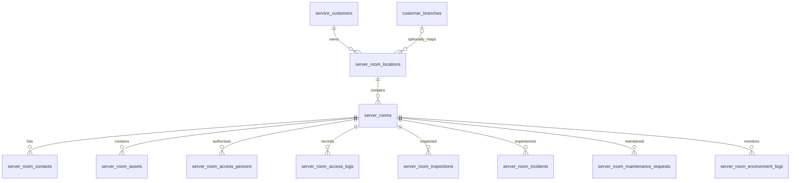
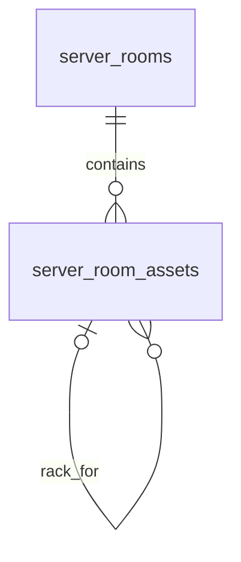
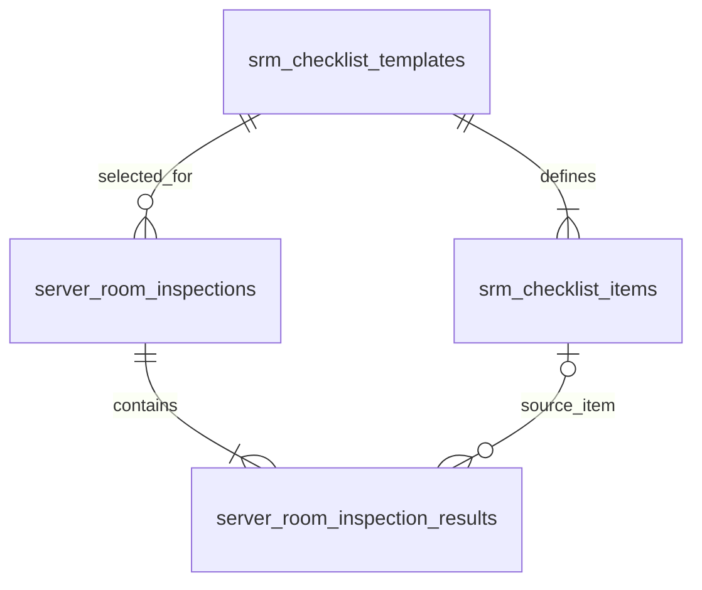
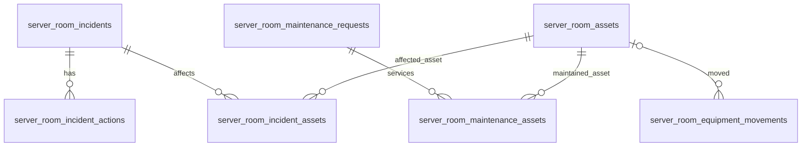

# SRM – ERD và quan hệ dữ liệu (bản thiết kế đề xuất)

> Trạng thái: DRAFT. Đây là ERD logic đề xuất, chưa phải schema được duyệt để chạy Migration. Các bảng và quan hệ phải được đối chiếu với database hiện tại trước khi triển khai.

## 1. Phân cấp tenant – địa điểm – phòng

- service_customers là tenant gốc.
- server_room_locations.customer_id xác định chủ thể quản lý dữ liệu.
- branch_id là liên kết tùy chọn tới chi nhánh của cùng khách hàng.
- Data Center là thông tin địa điểm/nhà cung cấp, không phải tenant thay thế khách hàng.
- Một location chứa nhiều server rooms; mỗi room thuộc đúng một location.

## 2. Tài sản và Rack

Đề xuất chưa tạo bảng Rack riêng. Rack được biểu diễn bằng một bản ghi trong server_room_assets có category=rack. Thiết bị đặt trong Rack tham chiếu bản ghi Rack đó:

- Bổ sung rack_asset_id BIGINT UNSIGNED NULL tự tham chiếu server_room_assets.id.
- Bổ sung rack_u_start SMALLINT UNSIGNED NULL.
- Bổ sung rack_u_height SMALLINT UNSIGNED NULL.
- Bổ sung rack_total_u SMALLINT UNSIGNED NULL, chỉ áp dụng khi bản ghi là Rack.
- Rack phải thuộc cùng customer_id và server_room_id với thiết bị được gắn vào.
- Rack không được tự tham chiếu chính nó; không cho Rack làm rack con của Rack khác trong mô hình đơn giản này.
- Kiểm tra trùng U và giới hạn rack_u_start + rack_u_height - 1 <= rack_total_u ở service layer/transaction.

Nếu về sau cần quản lý patch panel, PDU theo unit, sơ đồ mặt trước/sau hoặc rack cabinet có nhiều khoang, có thể tách Rack thành thực thể riêng.

## 3. Sự cố và bảo trì liên kết nhiều thiết bị

Một sự cố hoặc một đợt bảo trì có thể tác động đến nhiều thiết bị. Không đặt một asset_id duy nhất trong bảng cha hoặc lưu danh sách ID dạng JSON.

### server_room_incident_assets

| Cột | Kiểu dự kiến | Ghi chú |
|---|---|---|
| id | BIGINT UNSIGNED | PK |
| customer_id | BIGINT UNSIGNED | Tenant |
| incident_id | BIGINT UNSIGNED | FK sự cố |
| asset_id | BIGINT UNSIGNED | FK thiết bị |
| impact_note | TEXT NULL | Ảnh hưởng lên thiết bị |
| created_at | TIMESTAMP | |

Unique: (incident_id, asset_id). Sự cố và tài sản phải thuộc cùng tenant.

### server_room_maintenance_assets

| Cột | Kiểu dự kiến | Ghi chú |
|---|---|---|
| id | BIGINT UNSIGNED | PK |
| customer_id | BIGINT UNSIGNED | Tenant |
| maintenance_request_id | BIGINT UNSIGNED | FK yêu cầu bảo trì |
| asset_id | BIGINT UNSIGNED | FK thiết bị |
| work_note | TEXT NULL | Công việc trên thiết bị |
| created_at | TIMESTAMP | |

Unique: (maintenance_request_id, asset_id). Yêu cầu bảo trì và tài sản phải cùng tenant. Có thể bổ sung relation_type nếu cần phân biệt affected/serviced/replaced.

## 4. Di chuyển thiết bị

server_room_equipment_movements cần hỗ trợ chuyển thiết bị giữa các phòng hoặc vị trí trong cùng tenant. Đề xuất thay server_room_id đơn bằng:

- from_server_room_id BIGINT UNSIGNED NULL
- to_server_room_id BIGINT UNSIGNED NULL
- asset_id BIGINT UNSIGNED NULL
- movement_type: check_in, check_out, relocate

Quy tắc dự kiến:
- check_in: from có thể NULL, to bắt buộc.
- check_out: from bắt buộc, to có thể NULL.
- relocate: from và to bắt buộc; có thể cùng phòng nếu chỉ đổi Rack/U.
- Nếu có asset_id, tài sản phải thuộc tenant và cần ghi snapshot tên/mã/serial ở phiếu để bảo toàn lịch sử.
- Khi movement được xác nhận, cập nhật vị trí hiện tại của asset trong cùng transaction; không cập nhật chỉ bằng cách sửa lịch sử movement.

## 5. Checklist và Inspection

- Template có version; không sửa nội dung phiên bản đã được duyệt/sử dụng theo cách làm thay đổi lịch sử.
- Inspection lưu template_id và template_version.
- Result lưu snapshot mã, tên, mô tả và response type của checklist item.
- checklist_item_id có thể NULL nếu item nguồn bị archive; snapshot vẫn đủ để hiển thị lịch sử.
- Phiếu đã submit không được thay đổi âm thầm; mọi reopen/correction cần audit.

## 6. Incident, action, maintenance, movement

## 7. Approval, Attachment, Audit

server_room_approvals, server_room_attachments, server_room_audit_logs dự kiến dùng polymorphic key (type/id).

Ưu điểm: gắn được nhiều loại đối tượng SRM. Hạn chế: MySQL không thể đặt một FK thông thường từ ID đến nhiều bảng khác nhau.

Bắt buộc:
- Validate object tồn tại và thuộc đúng customer_id ở service layer.
- Không cho client tự truyền class/type tùy ý; dùng allowlist model type.
- Tải file phải authorize tenant và đối tượng trước khi trả file.
- Audit log append-only ở tầng ứng dụng; hạn chế quyền sửa/xóa.
- Nếu cần FK cứng tuyệt đối, thay polymorphic bằng bảng cha chung hoặc bảng liên kết chuyên biệt; cần cân nhắc chi phí và độ phức tạp.

## 8. Tenant integrity và FK đề xuất

Đối với bảng cha có tenant, cân nhắc unique key ghép (id, customer_id), sau đó bảng con tham chiếu cả hai cột. Ví dụ:

- server_room_locations: UNIQUE (id, customer_id).
- server_rooms: UNIQUE (id, customer_id).
- server_room_assets: UNIQUE (id, customer_id, server_room_id) nếu cần kiểm soát đồng thời tenant và room.
- srm_checklist_templates: UNIQUE (id, customer_id).

Khi dùng composite FK, cột con phải có đúng kiểu, thứ tự và index tương ứng. Với FK đến users, cần xác định user nội bộ và user khách hàng có được phép thao tác trên tenant nào; không thể chỉ dựa vào users.id để suy ra quyền.

Không tự ý thêm/sửa unique index trên các bảng hiện hữu trước khi kiểm tra duplicate data và tác động đến quan hệ hiện tại.

## 9. Quy tắc xóa dữ liệu đề xuất

| Quan hệ | Quy tắc đề xuất | Lý do |
|---|---|---|
| Customer → Location | RESTRICT / soft delete | Bảo toàn dữ liệu khách hàng |
| Location → Room | RESTRICT / soft delete | Không xóa phòng còn hồ sơ |
| Room → Assets | RESTRICT / soft delete | Bảo toàn kiểm kê |
| Room → Access Logs | RESTRICT | Nhật ký phải giữ |
| Room → Inspections | RESTRICT | Hồ sơ kiểm tra phải giữ |
| Inspection → Results | CASCADE chỉ khi xóa phiếu nháp chưa submit; còn lại RESTRICT | Không mất lịch sử |
| Incident → Actions | RESTRICT sau khi phát sinh; dùng trạng thái | Bảo toàn khắc phục |
| Asset → Movement | RESTRICT | Bảo toàn lịch sử di chuyển |
| User → actor fields | SET NULL khi phù hợp | Giữ hồ sơ khi user bị xóa |
| Checklist Item → Result | SET NULL | Snapshot giữ dữ liệu cũ |
| Approval/Attachment/Audit | Không cascade từ đối tượng nghiệp vụ đã lưu trữ | Bảo toàn bằng chứng và audit |

Hành vi xóa cuối cùng phải đối chiếu với soft-delete và chính sách retention hiện hữu.

## 10. Những điểm chưa được chốt

1. Có cần Rack layout 2D/3D, front/rear view hoặc patch panel hay không.
2. Quy tắc di chuyển giữa các khách hàng: đề xuất cấm; chỉ movement trong cùng tenant.
3. Có cần nhiều người phê duyệt đồng thời ở một bước hay chỉ tuần tự.
4. Người dùng ngoài hệ thống được ghi nhận bằng snapshot hay cần bảng danh bạ riêng.
5. Có cần sensor integration để tự động ghi Environment Logs ở giai đoạn đầu.
6. Chính sách retention, lưu trữ và xóa file/audit.
7. Xác minh khả năng hỗ trợ composite FK của schema hiện hữu và quy ước migration.

## 11. Phạm vi bảng sau rà soát ERD

- 18 bảng nghiệp vụ cốt lõi đã liệt kê trong Data Dictionary.
- 2 bảng liên kết đề xuất: server_room_incident_assets, server_room_maintenance_assets.
- Rack chưa cần bảng riêng; dùng self-reference trên server_room_assets.

Tổng dự kiến: 20 bảng (18 core + 2 pivot), chưa tính các bảng danh mục dùng chung nếu phân tích sau này chứng minh cần thiết.
