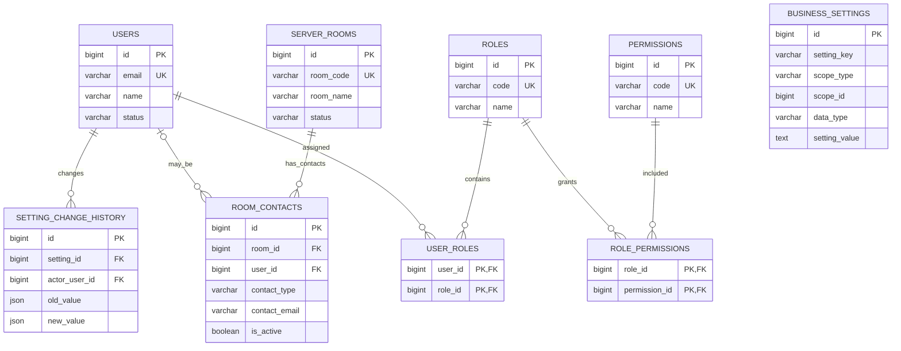

# ERD VẬT LÝ – SƠ ĐỒ QUAN HỆ PL1–PL5
**Phiên bản:** 0.3 – Đã áp dụng ADR-001 và ADR-002; dự thảo trực quan hóa từ ERD logic và Data Dictionary  
**Nhánh:** `feature/ITSMWEB`  
**CSDL mục tiêu:** MySQL 8.0 / InnoDB  
**Trạng thái:** DRAFT – chưa triển khai Migration

> Sơ đồ dưới đây biểu diễn quan hệ logic và FK dự kiến. Các bảng được chia thành nhóm để dễ đọc; các cột chi tiết xem tại `DATA_DICTIONARY.md`. Audit và Evidence liên kết bằng FK tới supertype `business_entities` theo ADR-001.

## 1. Tổng quan các miền dữ liệu

```mermaid
flowchart TB
    subgraph CORE["CORE – Nền tảng"]
      U[users]
      R[roles]
      P[permissions]
      UR[user_roles]
      RP[role_permissions]
      SR[server_rooms]
      BE[business_entities]
      RC[room_contacts]
      BS[business_settings]
      SH[setting_change_history]
    end

    subgraph PL1["PL1 – Access Authorization"]
      AReq[pl1_access_requests]
      ADec[pl1_approval_decisions]
      ARec[pl1_access_records]
      AHist[pl1_access_record_history]
      ATok[pl1_action_tokens]
    end

    subgraph PL2["PL2 – Visit / Entry / Exit"]
      Visit[pl2_visits]
      VHist[pl2_approval_history]
      VTok[pl2_action_tokens]
      OTP[pl2_otp_challenges]
      OTPA[pl2_otp_attempts]
      VEvent[pl2_visit_events]
    end

    subgraph PL3["PL3 – Inspection"]
      Insp[pl3_inspections]
      Item[pl3_checklist_items]
      Result[pl3_inspection_results]
      Ack[pl3_acknowledgements]
      ERun[pl3_escalation_runs]
      EEvent[pl3_escalation_events]
      Outbox[pl3_integration_outbox]
    end

    subgraph PL4["PL4 – Issue Management"]
      Issue[pl4_issues]
      Assign[pl4_assignments]
      Report[pl4_work_reports]
      Confirm[pl4_uoa_confirmations]
      IHist[pl4_issue_status_history]
    end

    subgraph PL5["PL5 – Work & Maintenance"]
      Catalog[pl5_work_catalog_items]
      Category[pl5_work_catalog_categories]
      Plan[pl5_maintenance_plans]
      Work[pl5_work_requests]
      WApproval[pl5_work_approvals]
      WAssign[pl5_work_assignments]
      Exec[pl5_work_execution_events]
      Verify[pl5_work_verifications]
    end

    subgraph COMMON["COMMON – Dịch vụ dùng chung"]
      EQ[email_queue]
      EQA[email_queue_attempts]
      Audit[system_audit_logs]
      Evidence[evidence_files]
      ELink[entity_evidence_links]
      Idem[idempotency_keys]
      Int[integration_events]
      Jobs[scheduled_job_runs]
      Export[data_exports]
    end

    U --- UR
    R --- UR
    R --- RP
    P --- RP
    BE --- AReq\n    BE --- ARec\n    BE --- Visit\n    BE --- Insp\n    BE --- Issue\n    BE --- Work\n    BE --- Audit\n    BE --- ELink\n    SR --- RC
    SR --- AReq
    SR --- ARec
    SR --- Visit
    SR --- Insp
    SR --- Issue
    SR --- Work
    AReq --- ADec
    AReq --- ARec
    ARec --- AHist
    AReq --- ATok
    Visit --- VHist
    Visit --- VTok
    Visit --- OTP
    OTP --- OTPA
    Visit --- VEvent
    Insp --- Result
    Item --- Result
    Insp --- Ack
    Insp --- ERun
    ERun --- EEvent
    Result --- Outbox
    Result --- Issue
    Issue --- Assign
    Issue --- Report
    Issue --- Confirm
    Issue --- IHist
    Category --- Catalog
    Catalog --- Plan
    Catalog --- Work
    Plan --- Work
    Work --- WApproval
    Work --- WAssign
    Work --- Exec
    Work --- Verify
    EQ --- EQA
    Evidence --- ELink
```

## 2. CORE – Tài khoản, phân quyền và danh mục phòng



## 3. PL1 – Access Authorization

```mermaid
erDiagram
    SERVER_ROOMS ||--o{ PL1_ACCESS_REQUESTS : receives
    PL1_ACCESS_REQUESTS ||--o{ PL1_APPROVAL_DECISIONS : has
    PL1_ACCESS_REQUESTS ||--o{ PL1_ACTION_TOKENS : issues
    PL1_ACCESS_REQUESTS ||--o{ PL1_ACCESS_RECORDS : creates_or_changes
    PL1_ACCESS_RECORDS ||--o{ PL1_ACCESS_RECORD_HISTORY : records

    PL1_ACCESS_REQUESTS {
      bigint id PK
      bigint business_entity_id FK,UK\n      varchar request_code UK
      bigint room_id FK
      varchar request_type
      varchar person_email
      varchar approval_status
      datetime submitted_at
    }
    PL1_APPROVAL_DECISIONS {
      bigint id PK
      bigint access_request_id FK
      varchar decision
      varchar channel
      datetime decided_at
    }
    PL1_ACTION_TOKENS {
      bigint id PK
      bigint access_request_id FK
      char token_hash UK
      varchar purpose
      datetime expires_at
      datetime used_at
    }
    PL1_ACCESS_RECORDS {
      bigint id PK
      bigint business_entity_id FK,UK\n      bigint room_id FK
      bigint created_from_request_id FK
      bigint last_changed_by_request_id FK
      varchar person_email
      varchar record_status
      date valid_from
      date valid_until
    }
    PL1_ACCESS_RECORD_HISTORY {
      bigint id PK
      bigint access_record_id FK
      bigint access_request_id FK
      varchar change_type
      json old_values
      json new_values
    }
```

**Điểm cần kiểm soát:** `pl1_access_records` không đặt UNIQUE cứng trên `(person_email, room_id)` ở giai đoạn này vì quy tắc cho phép tái sử dụng dòng REVOKED và phải bảo toàn lịch sử. Service phải khóa bản ghi phù hợp trong transaction để tránh hai yêu cầu NEW đồng thời cấp trùng quyền.

## 4. PL2 – Visit / Approval / OTP / Check-in / Check-out

```mermaid
erDiagram
    SERVER_ROOMS ||--o{ PL2_VISITS : receives
    PL2_VISITS ||--o{ PL2_APPROVAL_HISTORY : records
    PL2_VISITS ||--o{ PL2_ACTION_TOKENS : issues
    PL2_VISITS ||--o{ PL2_OTP_CHALLENGES : requests
    PL2_OTP_CHALLENGES ||--o{ PL2_OTP_ATTEMPTS : tracks
    PL2_VISITS ||--o{ PL2_VISIT_EVENTS : records

    PL2_VISITS {
      bigint id PK
      bigint business_entity_id FK,UK\n      varchar visit_code UK
      bigint room_id FK
      varchar requester_email
      varchar approver_email_snapshot
      varchar approval_status
      varchar visit_status
      datetime checked_in_at
      datetime checked_out_at
    }
    PL2_APPROVAL_HISTORY {
      bigint id PK
      bigint visit_id FK
      varchar action_code
      varchar result
      varchar channel
      datetime occurred_at
    }
    PL2_ACTION_TOKENS {
      bigint id PK
      bigint visit_id FK
      varchar purpose
      char token_hash UK
      datetime expires_at
      datetime used_at
      datetime revoked_at
    }
    PL2_OTP_CHALLENGES {
      bigint id PK
      bigint visit_id FK
      char otp_hash
      varchar status
      datetime sent_at
      datetime expires_at
      int failed_attempts
    }
    PL2_OTP_ATTEMPTS {
      bigint id PK
      bigint otp_challenge_id FK
      varchar result
      datetime attempted_at
    }
    PL2_VISIT_EVENTS {
      bigint id PK
      bigint visit_id FK
      varchar event_code
      varchar actor_type
      datetime occurred_at
    }
```

## 5. PL3 – Inspection / Checklist / Escalation / PL4 Outbox

```mermaid
erDiagram
    SERVER_ROOMS ||--o{ PL3_INSPECTIONS : inspected
    PL3_INSPECTIONS ||--|{ PL3_INSPECTION_RESULTS : contains
    PL3_CHECKLIST_ITEMS ||--o{ PL3_INSPECTION_RESULTS : evaluated
    PL3_INSPECTIONS ||--o{ PL3_ACKNOWLEDGEMENTS : acknowledged
    SERVER_ROOMS ||--o{ PL3_ESCALATION_RUNS : schedules
    PL3_ESCALATION_RUNS ||--o{ PL3_ESCALATION_EVENTS : emits
    EMAIL_QUEUE o|--o{ PL3_ESCALATION_EVENTS : delivers
    PL3_INSPECTIONS ||--o{ PL3_INTEGRATION_OUTBOX : produces
    PL3_INSPECTION_RESULTS ||--o{ PL3_INTEGRATION_OUTBOX : references

    PL3_INSPECTIONS {
      bigint id PK
      bigint business_entity_id FK,UK\n      varchar inspection_code UK
      bigint room_id FK
      varchar frequency
      date inspection_date
      varchar conclusion
    }
    PL3_CHECKLIST_ITEMS {
      bigint id PK
      varchar item_code UK
      varchar title_vi
      boolean is_active
    }
    PL3_INSPECTION_RESULTS {
      bigint id PK
      bigint inspection_id FK
      bigint checklist_item_id FK
      varchar result
      text remarks_action
    }
    PL3_ACKNOWLEDGEMENTS {
      bigint id PK
      bigint inspection_id FK
      varchar status
      datetime acknowledged_at
    }
    PL3_ESCALATION_RUNS {
      bigint id PK
      bigint room_id FK
      date work_date
      varchar schedule_type
      datetime deadline_at
      UNIQUE room_id, work_date, schedule_type
      varchar status
      json config_snapshot
      datetime started_at
      datetime stopped_at
    }
    PL3_ESCALATION_EVENTS {
      bigint id PK
      bigint escalation_run_id FK
      int level
      varchar status
      UNIQUE escalation_run_id, level
      varchar recipient_type
      varchar recipient_email_snapshot
      datetime scheduled_at
      datetime attempted_at
      datetime sent_at
      bigint email_queue_id FK
      int attempt_count
    }
    PL3_INTEGRATION_OUTBOX {
      bigint id PK
      bigint inspection_id FK
      bigint inspection_result_id FK
      varchar event_key UK
      varchar status
    }
```

## 6. PL4 – Issue / Assignment / Work Report / UOA Confirmation

```mermaid
erDiagram
    SERVER_ROOMS ||--o{ PL4_ISSUES : contains
    PL3_INSPECTION_RESULTS o|--o| PL4_ISSUES : may_create
    PL4_ISSUES ||--o{ PL4_ASSIGNMENTS : assigned
    PL4_ISSUES ||--o{ PL4_WORK_REPORTS : receives
    PL4_ASSIGNMENTS o|--o{ PL4_WORK_REPORTS : context
    PL4_ISSUES ||--o{ PL4_UOA_CONFIRMATIONS : reviewed
    PL4_WORK_REPORTS ||--o{ PL4_UOA_CONFIRMATIONS : evaluated
    PL4_ISSUES ||--o{ PL4_ISSUE_STATUS_HISTORY : changes

    PL4_ISSUES {
      bigint id PK
      bigint business_entity_id FK,UK\n      varchar issue_code UK
      bigint room_id FK
      bigint source_inspection_result_id FK
      varchar source_type
      varchar status
    }
    PL4_ASSIGNMENTS {
      bigint id PK
      bigint issue_id FK
      varchar assignee_email_snapshot
      datetime assigned_at
      datetime claimed_at
    }
    PL4_WORK_REPORTS {
      bigint id PK
      bigint issue_id FK
      bigint assignment_id FK
      varchar report_result
      text action_taken
      datetime submitted_at
    }
    PL4_UOA_CONFIRMATIONS {
      bigint id PK
      bigint issue_id FK
      bigint work_report_id FK
      varchar decision
      text reason
      datetime decided_at
    }
    PL4_ISSUE_STATUS_HISTORY {
      bigint id PK
      bigint issue_id FK
      varchar from_status
      varchar to_status
      datetime changed_at
    }
```

**Ràng buộc:** `source_inspection_result_id` UNIQUE và NULL được phép. Với MySQL, nhiều NULL vẫn có thể tồn tại trong UNIQUE; do đó ISSUE MANUAL không bị chặn. Một kết quả checklist PL3 chỉ được liên kết tối đa một ISSUE PL4.

## 7. PL5 – Work Catalog / Maintenance / Approval / Execution / Verification

```mermaid
erDiagram
    SERVER_ROOMS ||--o{ PL5_MAINTENANCE_PLANS : plans
    SERVER_ROOMS ||--o{ PL5_WORK_REQUESTS : receives
    PL5_WORK_CATALOG_CATEGORIES ||--o{ PL5_WORK_CATALOG_ITEMS : groups
    PL5_WORK_CATALOG_ITEMS o|--o{ PL5_MAINTENANCE_PLANS : classifies
    PL5_WORK_CATALOG_ITEMS o|--o{ PL5_WORK_REQUESTS : classifies
    PL5_MAINTENANCE_PLANS o|--o{ PL5_WORK_REQUESTS : generates
    PL5_WORK_REQUESTS ||--o{ PL5_WORK_APPROVALS : decided
    PL5_WORK_REQUESTS ||--o{ PL5_WORK_ASSIGNMENTS : assigned
    PL5_WORK_REQUESTS ||--o{ PL5_WORK_EXECUTION_EVENTS : executed
    PL5_WORK_ASSIGNMENTS o|--o{ PL5_WORK_EXECUTION_EVENTS : context
    PL5_WORK_REQUESTS ||--o{ PL5_WORK_VERIFICATIONS : verified

    PL5_WORK_CATALOG_CATEGORIES {
      bigint id PK
      varchar code UK
      varchar name
    }
    PL5_WORK_CATALOG_ITEMS {
      bigint id PK
      bigint category_id FK
      varchar code UK
      varchar title
      boolean is_active
    }
    PL5_MAINTENANCE_PLANS {
      bigint id PK
      bigint room_id FK
      bigint catalog_item_id FK
      varchar plan_code UK
      datetime next_due_at
    }
    PL5_WORK_REQUESTS {
      bigint id PK
      bigint business_entity_id FK,UK\n      varchar work_code UK
      bigint room_id FK
      bigint catalog_item_id FK
      bigint maintenance_plan_id FK
      varchar approval_status
      varchar work_status
    }
    PL5_WORK_APPROVALS {
      bigint id PK
      bigint work_request_id FK
      varchar decision
      varchar channel
      datetime decided_at
    }
    PL5_WORK_ASSIGNMENTS {
      bigint id PK
      bigint work_request_id FK
      varchar executor_email_snapshot
      datetime assigned_at
    }
    PL5_WORK_EXECUTION_EVENTS {
      bigint id PK
      bigint work_request_id FK
      bigint assignment_id FK
      varchar event_code
      datetime occurred_at
    }
    PL5_WORK_VERIFICATIONS {
      bigint id PK
      bigint work_request_id FK
      varchar decision
      datetime verified_at
    }
```

## 8. COMMON – Email, Audit, Evidence và Idempotency

```mermaid
erDiagram
    EMAIL_QUEUE ||--o{ EMAIL_QUEUE_ATTEMPTS : attempts
    BUSINESS_ENTITIES o|--o{ SYSTEM_AUDIT_LOGS : audited\n    BUSINESS_ENTITIES ||--o{ ENTITY_EVIDENCE_LINKS : evidence_for\n    USERS o|--o{ SYSTEM_AUDIT_LOGS : acts
    USERS o|--o{ EVIDENCE_FILES : uploads
    EVIDENCE_FILES ||--o{ ENTITY_EVIDENCE_LINKS : linked
    USERS ||--o{ DATA_EXPORTS : requests

    EMAIL_QUEUE {
      bigint id PK
      varchar event_key UK
      varchar module_code
      varchar status
      datetime next_attempt_at
    }
    EMAIL_QUEUE_ATTEMPTS {
      bigint id PK
      bigint email_queue_id FK
      int attempt_no
      varchar outcome
    }
    SYSTEM_AUDIT_LOGS {
      bigint id PK
      char event_uuid UK
      varchar module
      varchar entity_type
      bigint entity_id
      varchar event_code
      varchar result
      varchar action_channel
      varchar correlation_id
      datetime occurred_at
    }
    EVIDENCE_FILES {
      bigint id PK
      char file_uuid UK
      varchar storage_key UK
      char sha256
      bigint uploaded_by_user_id FK
    }
    ENTITY_EVIDENCE_LINKS {
      bigint id PK
      bigint evidence_file_id FK
      varchar module_code
      varchar entity_type
      bigint entity_id
    }
    IDEMPOTENCY_KEYS {
      bigint id PK
      varchar scope
      varchar idempotency_key
      varchar status
    }
    DATA_EXPORTS {
      bigint id PK
      bigint requested_by_user_id FK
      varchar export_code UK
      varchar status
    }
```

### 8.1 Định danh hồ sơ bằng Supertype/Subtype

Theo ADR-001 đã được phê duyệt, Audit và Evidence không còn dùng cặp polymorphic `module/entity_type + entity_id` làm khóa liên kết. Cả hai tham chiếu `business_entities.id` bằng FK.

Các bảng hồ sơ gốc trong phạm vi phải có `business_entity_id BIGINT UNSIGNED NOT NULL UNIQUE` FK tới `business_entities.id`: PL1 Access Request, PL1 Access Record, PL2 Visit, PL3 Inspection, PL4 Issue và PL5 Work Request. Mỗi dòng subtype được tạo cùng dòng supertype trong một transaction.

FK từ Audit/Evidence tới supertype bảo đảm định danh được tham chiếu tồn tại. Tuy nhiên, MySQL FK không tự bảo đảm mọi supertype có đúng một subtype hoặc `entity_type` khớp bảng subtype. Service phải kiểm tra điều này; UNIQUE FK bảo đảm một supertype không gắn nhiều dòng cùng bảng subtype.

Audit event không gắn hồ sơ (ví dụ sự kiện hệ thống) được phép để `business_entity_id = NULL`. Các bảng con/lịch sử không có registry riêng; sự kiện của chúng liên kết về hồ sơ gốc.

## 9. Quy tắc transaction và concurrency cần thể hiện trong code

1. **PL1 NEW:** transaction khóa theo chuẩn hóa `person_email + room_id`, kiểm tra ACTIVE và tạo/cập nhật Access Record. Chặn hai yêu cầu đồng thời cấp quyền trùng.
2. **PL1 CHANGE/REVOKE:** SELECT ... FOR UPDATE bản ghi ACTIVE đúng phòng; kiểm tra lại điều kiện ngay trước khi commit.
3. **PL2 Approval:** conditional update chỉ khi approval_status=PENDING; chỉ một người duyệt thắng race.
4. **PL2 OTP:** challenge chỉ được VERIFIED một lần; khóa challenge khi đạt 5 lần sai; OTP mới vô hiệu hóa challenge trước đó.
5. **PL2 Check-in/out:** conditional update theo Visit status; Check-out chỉ khi OPEN.
6. **PL3 submit:** idempotency theo Form Response ID; tạo Inspection + 12 results trong một transaction.
7. **PL3 → PL4:** ghi Outbox trong transaction; worker tạo Issue với UNIQUE source result; retry an toàn.
8. **PL4 UOA:** mỗi quyết định gắn với Work Report cụ thể; chỉ chuyển CLOSED khi UOA xác nhận đúng báo cáo.
9. **PL5 approval/verification:** conditional transition theo trạng thái hiện tại; không để requester tự approve hoặc executor tự verify.
10. **Email:** enqueue cùng transaction nghiệp vụ qua outbox; worker claim bằng lock; không giữ transaction DB trong lúc gọi SMTP.
11. **Audit:** ghi Audit event cùng transaction với thay đổi nghiệp vụ; lỗi ghi Audit bắt buộc rollback thay đổi quan trọng.
12. **Evidence:** upload file vào vùng quarantine, kiểm tra MIME/kích thước/virus nếu có, tính SHA-256 rồi mới cho liên kết vào hồ sơ.

## 10. Các điểm kiến trúc cần chốt trước Migration

| # | Vấn đề | Khuyến nghị thiết kế | Trạng thái |
|---:|---|---|---|
| 1 | Audit/Evidence định danh hồ sơ | Supertype/Subtype qua `business_entities`, FK từ Audit/Evidence | ĐÃ PHÊ DUYỆT – ADR-001 |
| 2 | Access Record identity | Không UNIQUE email+room trên toàn lịch sử; khóa bản ghi hiện hành trong transaction | Nguyên tắc đã xác định |
| 3 | PL3 escalation run | UNIQUE `(room_id, work_date, schedule_type)`; hiện chỉ `DAILY`; Event từng cấp qua Email Queue | ĐÃ PHÊ DUYỆT – ADR-002 |
| 4 | Form/API idempotency | Dùng `idempotency_keys` với scope + key unique và request hash | Đề xuất |
| 5 | External actor | Lưu actor snapshot; chỉ tạo external_contacts nếu cần quản lý vòng đời riêng | CHỜ CHỐT |
| 6 | Retention và WORM | Quyết định chính sách lưu trữ, archive, immutable storage trước production | CHỜ CHÍNH SÁCH |

## 11. Kết luận

Sơ đồ thể hiện cấu trúc quan hệ PL1–PL5 và các bảng dùng chung. Mô hình `business_entities` theo ADR-001 đã được áp dụng cho Audit/Evidence. Đây là bản ERD vật lý dự thảo, chưa tạo hoặc thay đổi database. Trước khi viết Migration, cần chốt các điểm ở Mục 10 và đối chiếu lại các câu hỏi nghiệp vụ còn mở trong `WORKFLOW_SPECIFICATION.md`.

Tài liệu liên quan:
- `ERD_DESIGN.md` – ERD logic.
- `DATA_DICTIONARY.md` – cột, kiểu dữ liệu, ràng buộc.
- `WORKFLOW_SPECIFICATION.md` – nghiệp vụ và quyết định đã chốt.
